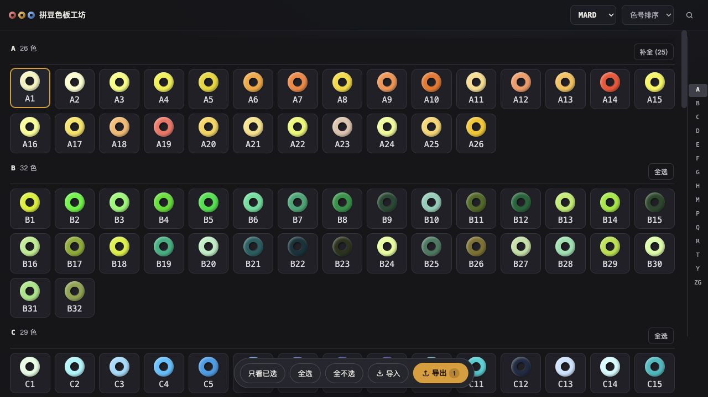

# 拼豆色板工坊 · Bead Palette

一款在浏览器中整理拼豆色号的工具。浏览色卡、挑选颜色，并将色板导出，方便在专业的像素软件如 Aseprite 中进行绘制，以及拼豆材料的日常管理。支持常见拼豆品牌的全色系，并可导出为.gpl 或者 excel 文件。



## 功能

- **AI 辅助批量导入**：用任意支持图片识别的 AI 助手识别色卡标签，粘贴结果后批量校验、加入色板。
- 按色号或色系浏览、搜索和选择颜色，支持批量选择。
- 切换品牌时保留已选颜色，并按当前品牌的色号显示和导出。
- 导入或导出 GPL 色板，导出包含色卡预览和详细数据的 Excel 文件。
- 颜色选择保存在浏览器本地，无需注册或安装。

## Tips: 拍照批量导入

给拼豆色卡标签拍照，将照片和工具提供的提示词发给你常用的 AI 助手；对照照片核对识别结果后，选择对应品牌，将色号粘贴到工具中。工具会校验色号并提示异常，确认后即可批量加入色板。


## 使用

- **网页版**：[beadpalette.top1pi.com](https://beadpalette.top1pi.com/)。
- **本地使用**：下载并解压整个项目，在本机的文件管理器中双击 `app/index.html`，即可在浏览器中直接使用。

## 开发与测试

本地开发也可以从项目目录启动静态文件服务：

```sh
python3 -m http.server 8000 --directory app
```

然后访问 `http://localhost:8000`。

使用 Node.js 运行回归测试，无需安装依赖：

```sh
node --test test/palette.test.cjs
```

Excel 文件由随项目分发的 [ExcelJS 4.4.0](app/vendor/README.md) 生成。

## 数据来源怎么连设计文档也放到了 GitHub 的发布包里吗？这是过程文件，不需要发布啊。

色板数据来自 [Zippland/perler-beads](https://github.com/Zippland/perler-beads)，版权 © Zippland。项目使用其 [colorSystemMapping.json](https://github.com/Zippland/perler-beads/blob/2519daf1628534e414bc7a10f0472dc32000bde4/src/app/colorSystemMapping.json) 转换为 `app/data.js`，包含 291 种颜色和五个品牌的色号。上游数据快照和许可声明详见 [第三方声明](THIRD_PARTY_NOTICES.md)。

色号映射来自社区数据，实际颜色和实物色号请以品牌色卡为准。数据中存在缺失或歧义的色号，工具会给出提示。

## 许可证

本工具按 [GNU Affero General Public License v3.0](LICENSE) 发布。随项目分发的 ExcelJS 和色库数据来源及许可证见 [第三方声明](THIRD_PARTY_NOTICES.md)。
